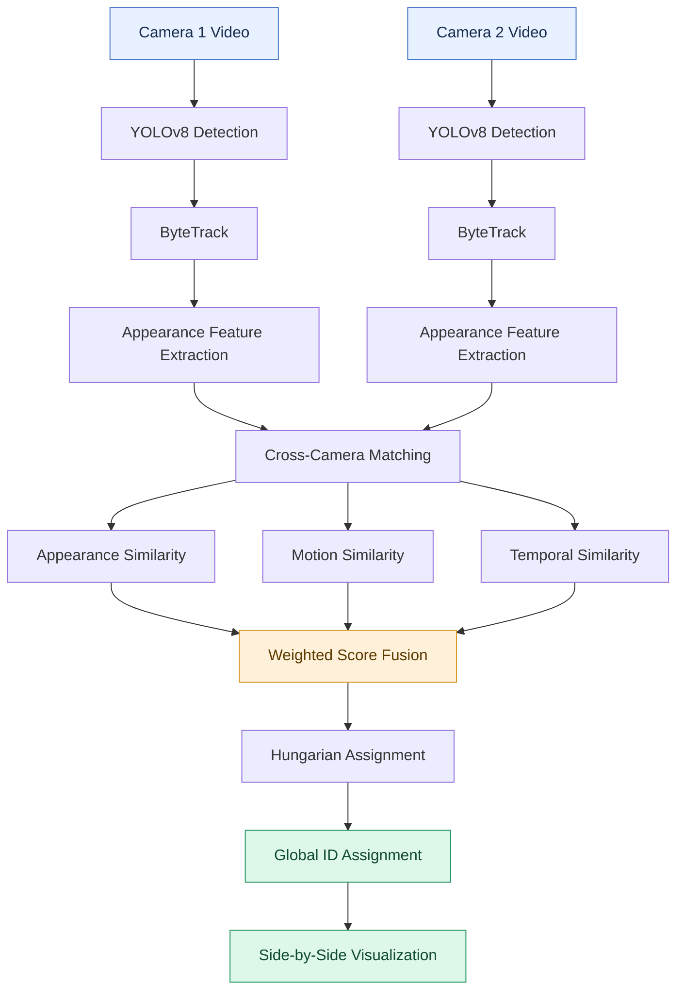

# Cross Camera ReID

### Multi-Object Re-Identification Across Multiple Camera Views

A computer vision project that matches objects across camera views by combining appearance, motion, spatial consistency, and temporal information.

 

 

**Detect &nbsp; • &nbsp; Track &nbsp; • &nbsp; Match &nbsp; • &nbsp; Re-identify**

---

## Overview

Tracking objects across multiple cameras requires more than detecting them in individual frames. The same object may appear at different positions, scales, and viewing angles, making cross-camera identity matching challenging.

**Cross Camera ReID** combines object detection, local tracking, visual appearance, motion patterns, spatial consistency, and temporal information to associate corresponding tracks across two synchronized camera views.

Each camera maintains its own local track IDs. The system compares tracks across cameras and assigns consistent global identities when a sufficiently reliable match is established.

The approach can be applied to different detectable object categories, such as people and vehicles, depending on the detection model and the suitability of the matching features.

## Features

<table>
<tr>
<td width="50%" valign="top">

### 🎯 Object Detection

Uses YOLOv8 to detect objects in video frames.

</td>
<td width="50%" valign="top">

### 🔗 Multi-Object Tracking

Uses ByteTrack to associate detections across consecutive frames.

</td>
</tr>
<tr>
<td width="50%" valign="top">

### 🎨 Appearance Matching

Combines ResNet50 visual embeddings with HSV colour histograms.

</td>
<td width="50%" valign="top">

### 🏃 Motion Analysis

Compares movement speeds, speed patterns, directions, and spatial consistency.

</td>
</tr>
<tr>
<td width="50%" valign="top">

### ⏱️ Temporal Matching

Uses track lifetimes, first-appearance timing, and temporal overlap.

</td>
<td width="50%" valign="top">

### 🌐 Global Identity Assignment

Uses weighted similarity scores and the Hungarian algorithm to match tracks across cameras.

</td>
</tr>
<tr>
<td width="50%" valign="top">

### 📐 Spatial Relationship Estimation

Uses OpenCV and background features to estimate a homography between camera views.

</td>
<td width="50%" valign="top">

### 🎬 Combined Visualization

Displays both camera views side by side for inspecting tracking and identity assignments.

</td>
</tr>
</table>

---

## How It Works

### 1. Object Detection and Local Tracking

YOLOv8 detects objects in each frame, generating bounding boxes around detected instances.

ByteTrack associates detections across consecutive frames and maintains local track IDs independently for each camera.

### 2. Appearance Feature Extraction

The system extracts visual embeddings using a ResNet50 model and calculates HSV colour histograms for the upper and lower portions of each detected object's bounding box.

These features help measure visual similarity between tracks observed in different camera views.

### 3. Motion Analysis

The system compares multiple movement characteristics:

- Normalized movement speed
- Speed-series correlation
- Movement direction
- Spatial consistency between camera views

These signals help determine whether tracks from different cameras exhibit compatible movement patterns.

### 4. Homography Estimation

OpenCV estimates a homography between the two camera views using background features.

The estimated transformation helps relate object positions between the views and contributes to spatial consistency checks during matching.

### 5. Temporal Analysis

The system considers:

- Track lifetimes
- Timing of first appearances
- Overlapping observation intervals

These temporal characteristics contribute to the similarity score and help evaluate whether a potential match is plausible.

### 6. Similarity Score Fusion

The system combines appearance, motion, and temporal similarity into a weighted score:

\[
\boxed{S = W_A S_A + W_M S_M + W_T S_T}
\]

Where:

| Symbol | Description |
|:--|:--|
| \(S_A\) | Appearance similarity |
| \(S_M\) | Motion similarity |
| \(S_T\) | Temporal similarity |
| \(W_A\) | Appearance weight |
| \(W_M\) | Motion weight |
| \(W_T\) | Temporal weight |

The current configuration uses the following weights:

| Component | Weight |
|:--|--:|
| Appearance similarity | 0.50 |
| Motion similarity | 0.35 |
| Temporal similarity | 0.15 |

Appearance receives the highest weight, while motion and temporal information provide additional evidence for cross-camera matching.

### 7. Cross-Camera Matching

The Hungarian algorithm finds one-to-one assignments between tracks from the two cameras.

The matching process incorporates:

- Weighted similarity scores
- Similarity thresholds
- Spatial constraints
- Exponential moving average (EMA) score smoothing
- A bonus for previously established matches
- Consecutive-match verification before global ID assignment

These mechanisms help reduce unstable associations and incorrect identity assignments.

### 8. Visualization

The final output displays the two camera views side by side, allowing the tracking results and cross-camera identity assignments to be inspected together.

---

## Matching Strategy

The system combines three complementary sources of information.

| Matching Signal | Information Used | Purpose |
|:--|:--|:--|
| **Appearance** | ResNet50 embeddings and HSV colour histograms | Compares visual characteristics |
| **Motion** | Speed, speed patterns, direction, and spatial consistency | Evaluates movement compatibility |
| **Temporal** | Track lifetimes and appearance timing | Evaluates temporal compatibility |

Combining these signals reduces dependence on appearance alone and provides multiple sources of evidence when matching tracks across cameras.

---

## Technology Stack

| Technology | Role |
|:--|:--|
| **Python** | Core implementation |
| **OpenCV** | Video processing, colour features, and homography estimation |
| **YOLOv8** | Object detection |
| **ByteTrack** | Within-camera multi-object tracking |
| **ResNet50** | Visual feature extraction |
| **NumPy** | Numerical computations and feature processing |
| **SciPy** | Hungarian assignment algorithm |

---

## Potential Applications

The underlying approach can be useful in several multi-camera video analysis scenarios.

| Application | Possible Use |
|:--|:--|
| 🚗 Traffic Monitoring | Associating detected vehicles across camera views |
| 👥 Surveillance | Matching detected people across multiple viewpoints |
| 🏙️ Smart Cities | Analysing object movement across monitored areas |
| 🏬 Retail Analytics | Studying object movement within monitored spaces |
| 📹 Video Analytics | Maintaining consistent identities across camera feeds |

*These are potential applications of the general approach, not claims that the current implementation has been validated for every object category or scenario.*

---

## Limitations

- **Camera configuration:** The current implementation is designed for two synchronized views of the same scene.
- **Detection performance:** Results depend on the detector's ability to recognize the objects in the videos.
- **Appearance differences:** Lighting, occlusion, similar-looking objects, and viewpoint changes can reduce matching accuracy.
- **Feature suitability:** The current appearance pipeline uses ResNet50 embeddings and colour histograms based on upper and lower bounding-box regions. These features may not be optimal for every object category.
- **Spatial estimation:** Motion matching depends on the quality of the estimated homography.
- **Tracking errors:** Incorrect or fragmented local tracks can affect cross-camera identity assignments.

---

## Project Goal

Demonstrate how **object detection, multi-object tracking, appearance recognition, motion analysis, temporal consistency, and assignment optimization** can work together to associate objects across multiple camera views.

 

### One System. Multiple Cameras. Consistent Identities.

**Cross Camera ReID**

