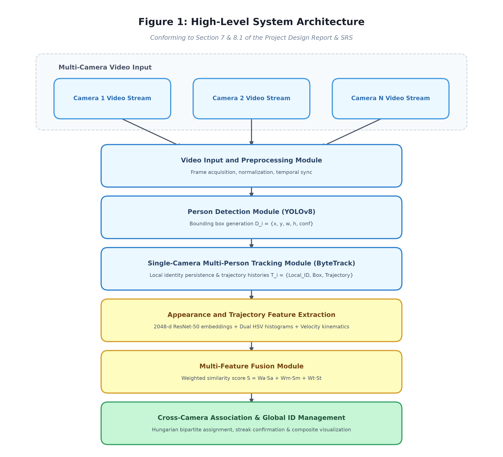
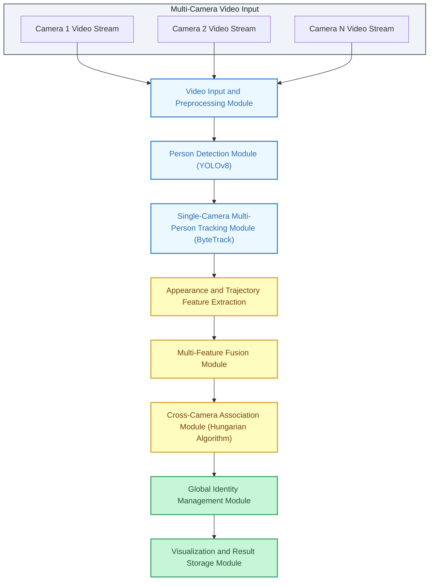
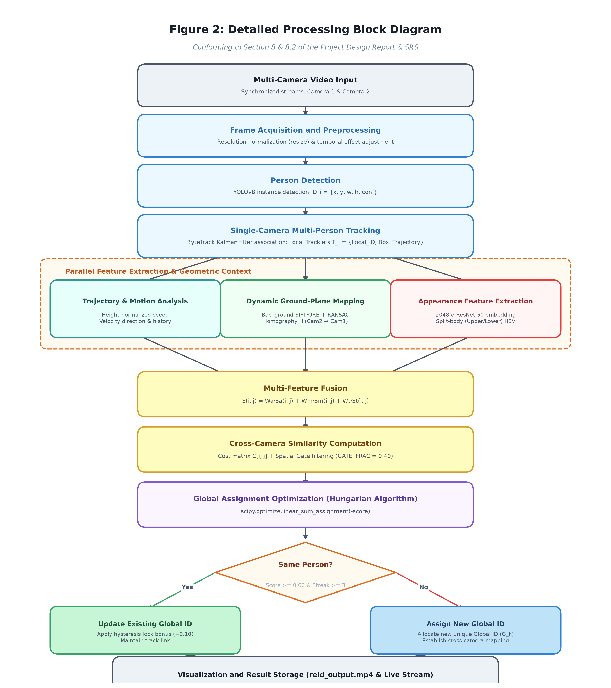
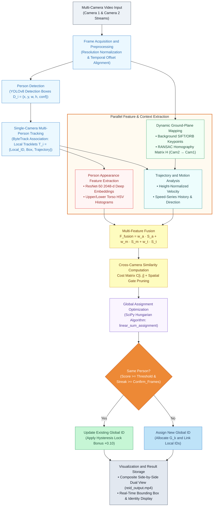
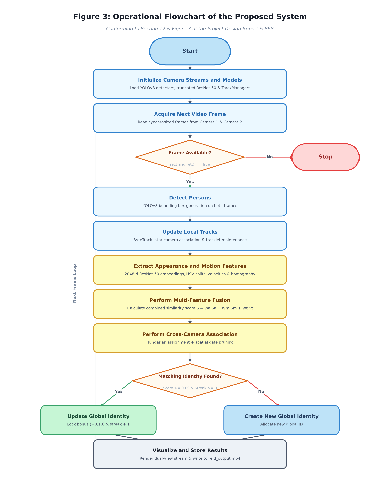
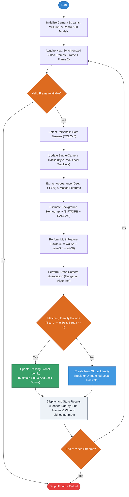
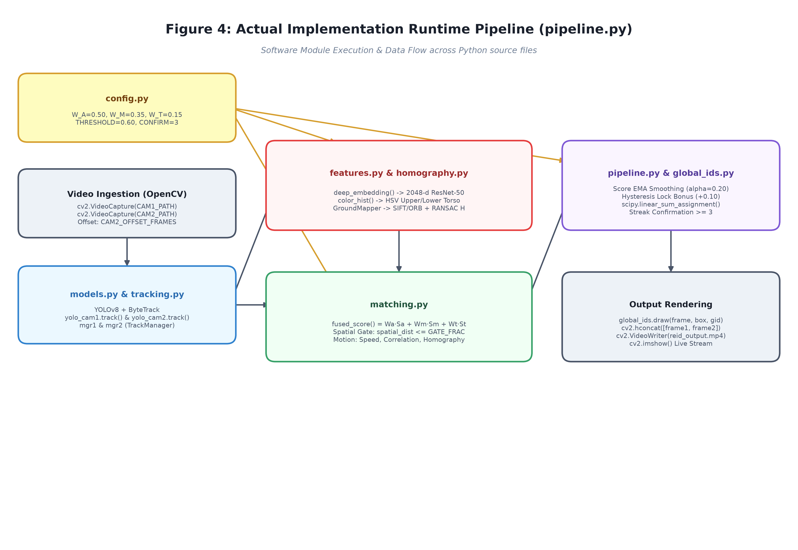
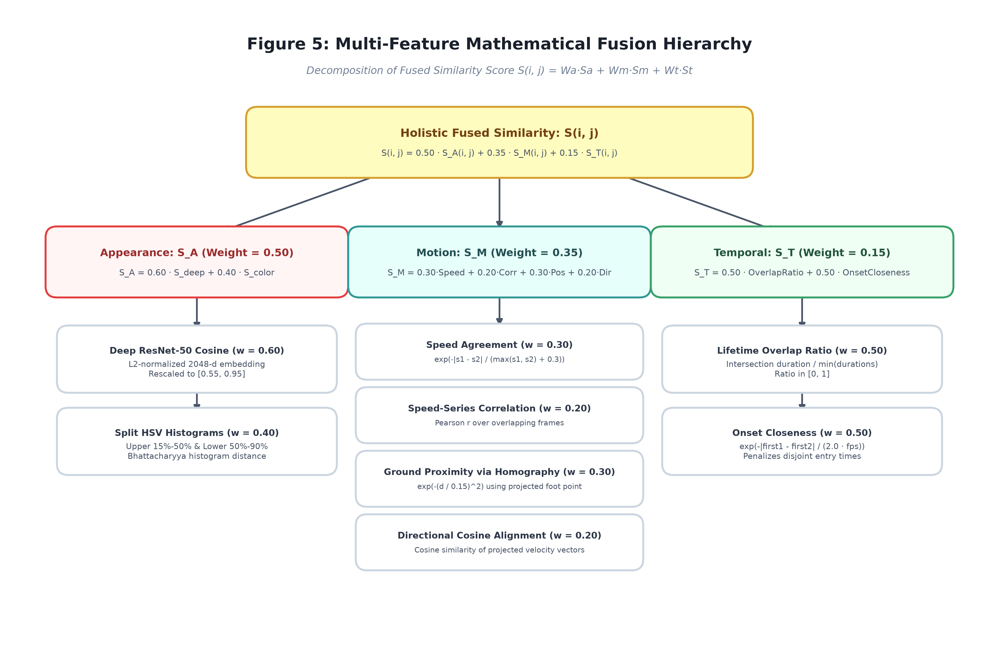
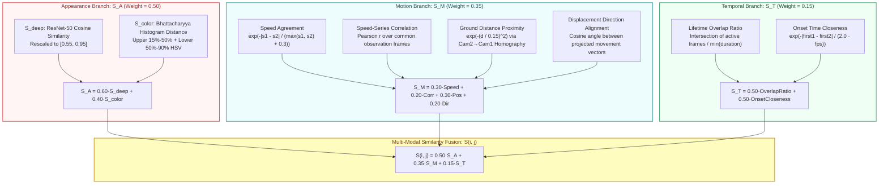

<div align="center">

# Multi-Feature Fusion Based Cross-Camera Person Tracking & Re-Identification

### Image & Video Processing (IVP) Project — Academic Year 2026–2027
**Department of Information Technology, Indian Institute of Information Technology Allahabad (IIIT-A)**

---

**IVP Group 17**  
*Vardaan Gupta (IIT2024046) • Parth Khatri (IIT2024002) • Hemant Singh (IIT2024047)*  
*Aryan Saini (IIT2024008) • Anshdeep Singh (IIT2024011) • Udaynoor Singh (IIT2024006) • Aditya Sirsalkar (IIT2024009)*

<br>

[](https://www.python.org/)
[](https://pytorch.org/)
[](https://opencv.org/)
[](https://github.com/ultralytics/ultralytics)
[](https://github.com/ifzhang/ByteTrack)
[](#)

<br>

**Detect &nbsp; • &nbsp; Track Locally &nbsp; • &nbsp; Homography Project &nbsp; • &nbsp; Fuse Features &nbsp; • &nbsp; Global Match &nbsp; • &nbsp; Re-Identify**

</div>

---

## 📑 Table of Contents
1. [Executive Summary & Motivation](#1-executive-summary--motivation)
2. [Base Paper & Literature Foundation](#2-base-paper--literature-foundation)
3. [System Architecture (SRS & Design Report Fig. 1)](#3-system-architecture-srs--design-report-fig-1)
4. [Detailed Processing Block Diagram (SRS & Design Report Fig. 2)](#4-detailed-processing-block-diagram-srs--design-report-fig-2)
5. [Operational System Flowchart (SRS & Design Report Fig. 3)](#5-operational-system-flowchart-srs--design-report-fig-3)
6. [Actual Implementation Runtime Pipeline & Module Flow](#6-actual-implementation-runtime-pipeline--module-flow)
7. [Mathematical Formulations & Fusion Hierarchy](#7-mathematical-formulations--fusion-hierarchy)
8. [Detailed Codebase & Module Walkthrough](#8-detailed-codebase--module-walkthrough)
9. [Current Implementation Status & SRS Compliance Matrix](#9-current-implementation-status--srs-compliance-matrix)
10. [Configuration & Hyperparameter Guide](#10-configuration--hyperparameter-guide)
11. [Installation, Setup & Execution](#11-installation-setup--execution)
12. [Evaluation Framework & Experimental Roadmap](#12-evaluation-framework--experimental-roadmap)
13. [References & Academic Attribution](#13-references--academic-attribution)

---

## 1. Executive Summary & Motivation

### The Challenge
Multi-Camera Multi-Target Tracking (MTMCT) and Cross-Camera Person Re-Identification (Re-ID) represent fundamental challenges in intelligent visual surveillance. While single-camera tracking has matured significantly, associating individuals across distinct, non-overlapping or partially overlapping camera views remains prone to failure due to:
* **Severe Appearance Shifts:** Drastic variations in illumination, pose, perspective angles, and camera sensor color responses.
* **Appearance Ambiguity:** Unrelated individuals wearing identical or visually indistinguishable clothing.
* **Physical Occlusions:** Dynamic crowding, temporary background occlusion, and blind zones between cameras.
* **Coordinate Disconnect:** Independent 2D camera pixel coordinates lack an intrinsic shared spatial metric.

### Our Solution
This project implements a robust, modular **Multi-Feature Fusion Based Cross-Camera Tracking System**. Instead of relying on visual appearance alone, our framework unifies **deep visual representations**, **color distribution histograms**, **kinematic velocity profiles**, **ground-plane homography projection**, and **temporal continuity cues**. 

By evaluating multi-modal compatibility through a smoothed cost matrix and solving the global assignment via the **Hungarian algorithm**, our system establishes stable, persistent **Global Identities** across disjoint camera feeds.

---

## 2. Base Paper & Literature Foundation

### 📄 Base Research Paper
> **Title:** *Cross-Camera Tracking Model and Method Based on Multi-Feature Fusion*  
> **Authors:** Peng Zhang, Siqi Wang, Wei Zhang, Weimin Lei, Xinlei Zhao, Qingyang Jing, and Mingxin Liu  
> **Journal:** *Symmetry*, MDPI, Vol. 15, No. 12, Article 2145, Dec 2023.  
> **DOI:** [10.3390/sym15122145](https://doi.org/10.3390/sym15122145)

The base paper establishes that single-feature matching degrades rapidly under realistic surveillance conditions. It proposes combining appearance features with motion and social trajectory modeling on a unified ground plane. Our project builds upon this core philosophy, creating an accessible, modular, and extensible implementation designed for real-world experimentation.

### 📚 Literature Survey Benchmark Comparison
Our literature study (cataloged in [`content/IVP_Group_17.xlsx`](file:///d:/Desktop/D%20Drive/Sem%205/IVP/IVP_project/Github/Cross-Camera-ReId/content/IVP_Group_17.xlsx)) surveys 15 state-of-the-art architectures:

| Method / Paper | Venue | Core Technique | Key Strengths | Limitations |
| :--- | :--- | :--- | :--- | :--- |
| **Zhang et al. (Base)** | MDPI Symmetry 2023 | YOLOX + ByteTrack + TransReID + Implicit Social Trajectory + Homography | 70.64% IDF1 on AI City '23; combines motion & appearance | Multi-component complexity; requires calibration |
| **ReidTrack (Specker et al.)** | CVPRW 2023 | YOLOv8 + Re-ID Embedding Clustering + ID Switch Filter | No calibration or homography required; fast | Fails with visually identical clothing |
| **LMGP (Nguyen et al.)** | CVPR 2022 | Foot-point ground projection + Lifted Multicut Graph | 98.2% IDF1 on Wildtrack; robust against heavy occlusion | Graph optimization computationally expensive |
| **DyGLIP (Quach et al.)** | CVPR 2021 | Dynamic Graph Link Prediction + Structural/Temporal Attention | Online tracking; learns fusion adaptively; 90.9 MOTA | Large graph scaling overhead |
| **ReST (Cheng et al.)** | ICCV 2023 | Spatial GNN + Temporal GNN Reconfigurable Graph | 85.7% IDF1 on Wildtrack; decoupling spatial & temporal graphs | Requires camera geometry |
| **i-STCRA (Huang et al.)** | CVPRW 2023 | BoT-SORT + Anchor Clustering + Iterative STCRA Reassignment | 95.36% IDF1 (1st Place AI City '23); self-calibration | Multi-stage offline post-processing |
| **Yang et al.** | CVPRW 2023 | Appearance + Spatial-Temporal Distance Fusion + Clustering | 93.31% IDF1 (3rd Place AI City '23) | Hand-crafted temporal constraints |
| **Our System** | IIIT-A IVP 2026 | **YOLOv8 + ByteTrack + Truncated ResNet-50 + Split HSV + Dynamic RANSAC Homography + Hungarian Matching** | Modular, online-capable, zero hardcoded calibration, temporal EMA smoothing, hysteresis locking | Currently dual-camera focused; evaluation pipeline ongoing |

---

## 3. System Architecture (SRS & Design Report Fig. 1)

The high-level architecture corresponds exactly to **Figure 1** of our formal **Software Requirements Specification (SRS)** and **Project Design Report**:

<div align="center">



*Figure 1: High-Level System Architecture (Three-tier pipeline: Video Ingestion & Preprocessing, Feature & Cross-Camera Association, and Global Identity Management & Rendering).*

</div>

<details>
<summary>▶ Click to inspect Mermaid diagram code</summary>


</details>

### Architectural Layering
1. **Input and Perception Layer:** Video stream ingestion, frame extraction, resolution normalization, temporal offset synchronization, YOLOv8 detection, and ByteTrack local identity maintenance.
2. **Feature and Association Layer:** Feature extraction (deep embeddings, HSV color splits, height-normalized velocities, trajectory histories), dynamic background SIFT/ORB homography estimation, multi-feature fusion, spatial gating, and Hungarian assignment.
3. **Identity and Output Layer:** Global identity allocation, bijective conflict prevention, streak confirmation ($N \ge 3$), hysteresis lock bonuses, and synchronized dual-view video rendering.

---

## 4. Detailed Processing Block Diagram (SRS & Design Report Fig. 2)

The detailed block processing architecture corresponds exactly to **Figure 2** of the **Project Design Report** and **SRS**:

<div align="center">



*Figure 2: Detailed Processing Block Diagram (Parallel Appearance, Motion, and Ground-Plane Mapping, followed by Multi-Feature Fusion, Hungarian Global Assignment, and Identity Lifecycle Management).*

</div>

<details>
<summary>▶ Click to inspect Mermaid diagram code</summary>


</details>

---

## 5. Operational System Flowchart (SRS & Design Report Fig. 3)

The complete end-to-end execution loop corresponds exactly to **Figure 3** of the **Project Design Report** and **SRS**:

<div align="center">



*Figure 3: Operational System Flowchart (Frame-by-frame synchronized execution loop, multi-feature fusion matching, streak verification, and real-time visualization output).*

</div>

<details>
<summary>▶ Click to inspect Mermaid diagram code</summary>


</details>

---

## 6. Actual Implementation Runtime Pipeline & Module Flow

This diagram details the actual codebase execution within [`pipeline.py`](file:///d:/Desktop/D%20Drive/Sem%205/IVP/IVP_project/Github/Cross-Camera-ReId/pipeline.py) and illustrates how data passes between all modular Python source files:

<div align="center">



*Figure 4: Actual Implementation Runtime Pipeline & Module Flow (Data flow and dependencies between config.py, models.py, tracking.py, features.py, homography.py, matching.py, global_ids.py, and pipeline.py).*

```mermaid
flowchart LR
    subgraph Config["config.py"]
        CFG["Constants & Weights<br/>W_A=0.50, W_M=0.35, W_T=0.15<br/>THRESHOLD=0.60, CONFIRM_FRAMES=3"]
    end

    subgraph Streams["Video Ingestion"]
        V1["cam1.mp4"] --> CAP1["cv2.VideoCapture"]
        V2["cam2.mp4"] --> CAP2["cv2.VideoCapture"]
        OFFSET["CAM2_OFFSET_FRAMES"] --> CAP2
    end

    subgraph Perception["models.py & tracking.py"]
        CAP1 --> Y1["yolo_cam1.track()"]
        CAP2 --> Y2["yolo_cam2.track()"]
        Y1 --> MGR1["mgr1: TrackManager(1)"]
        Y2 --> MGR2["mgr2: TrackManager(2)"]
    end

    subgraph Features["features.py & homography.py"]
        MGR1 & MGR2 --> EMB["features.deep_embedding()<br/>ResNet-50 2048-d (L2-norm)"]
        MGR1 & MGR2 --> HIST["features.color_hist()<br/>HSV Upper & Lower Torso"]
        CAP1 & CAP2 --> MAPPER["homography.GroundMapper<br/>SIFT/ORB Keypoints + RANSAC"]
    end

    subgraph Association["matching.py"]
        EMB & HIST --> SA["appearance_sim()"]
        MGR1 & MGR2 & MAPPER --> SM["motion_sim()"]
        MGR1 & MGR2 --> ST["temporal_sim()"]
        SA & SM & ST --> FUSED["fused_score()"]
        MAPPER --> GATE["spatial_dist() > GATE_FRAC?"]
    end

    subgraph GlobalOpt["pipeline.py & global_ids.py"]
        FUSED --> EMA["pair_ema (alpha=0.20)"]
        EMA --> GIDS_CHECK["gids.allowed() Bijective Check"]
        GIDS_CHECK --> LOCK["LOCK_BONUS (+0.10)"]
        LOCK --> HUNG["scipy.linear_sum_assignment(-score)"]
        HUNG --> STREAK["pair_streak >= CONFIRM_FRAMES (3)"]
        STREAK --> GLINK["gids.link(tid1, tid2)"]
    end

    subgraph Output["Output Rendering"]
        GLINK --> DRAW["global_ids.draw()<br/>Bounding box & Global ID"]
        DRAW --> HCONCAT["cv2.hconcat([frame1, frame2])"]
        HCONCAT --> VOUT["cv2.VideoWriter (reid_output.mp4)"]
        HCONCAT --> IMSHOW["cv2.imshow('Cross-Camera Re-ID')"]
    end

    CFG -.-> Association
    CFG -.-> GlobalOpt

    style Config fill:#FEFCBF,stroke:#D69E2E,color:#744210
    style Streams fill:#EDF2F7,stroke:#4A5568,color:#1A202C
    style Perception fill:#EBF8FF,stroke:#3182CE,color:#2B6CB0
    style Features fill:#FFF5F5,stroke:#E53E3E,color:#9B2C2C
    style Association fill:#F0FFF4,stroke:#38A169,color:#22543D
    style GlobalOpt fill:#FAF5FF,stroke:#805AD5,color:#553C9A
    style Output fill:#EDF2F7,stroke:#4A5568,color:#1A202C
```

</div>

<details>
<summary>▶ Click to inspect Mermaid diagram code</summary>


</details>

---

## 7. Mathematical Formulations & Fusion Hierarchy

### 7.1 Multi-Feature Fusion Tree
The structure of our multi-feature similarity metric is organized hierarchically:

<div align="center">



*Figure 5: Multi-Feature Similarity Fusion Hierarchy (Hierarchical decomposition of weights, appearance embeddings, color histograms, motion kinematics, and temporal overlap metrics).*

</div>

<details>
<summary>▶ Click to inspect Mermaid diagram code</summary>


</details>

### 7.2 Mathematical Formulations

#### 1. Fused Multi-Modal Score
The global similarity between tracklet $i$ from Camera 1 and tracklet $j$ from Camera 2 is computed as:

$$\boxed{S(i, j) = W_A \cdot S_A(i, j) + W_M \cdot S_M(i, j) + W_T \cdot S_T(i, j)}$$

*Subject to:* $W_A + W_M + W_T = 1.0$, with default baseline weights:
* **Appearance Weight ($W_A$):** $0.50$
* **Motion Weight ($W_M$):** $0.35$
* **Temporal Weight ($W_T$):** $0.15$

#### 2. Appearance Similarity ($S_A$)
$$S_A(i, j) = W_{\text{deep}} \cdot S_{\text{deep}}(i, j) + W_{\text{color}} \cdot S_{\text{color}}(i, j)$$

* **Deep Visual Embedding ($W_{\text{deep}} = 0.60$):** We truncate a pretrained ResNet-50 network directly after its Global Average Pooling layer, yielding an uncorrupted 2048-dimensional feature embedding $\mathbf{e} \in \mathbb{R}^{2048}$. The embedding is $L_2$-normalized:

  $$\hat{\mathbf{e}} = \frac{\mathbf{e}}{\|\mathbf{e}\|_2 + 10^{-8}}$$

  Cosine similarity is rescaled between $[\tau_{\text{low}}, \tau_{\text{high}}] = [0.55, 0.95]$:

  $$S_{\text{deep}}(i, j) = \text{clip}\left(\frac{\hat{\mathbf{e}}_i \cdot \hat{\mathbf{e}}_j - \tau_{\text{low}}}{\tau_{\text{high}} - \tau_{\text{low}}}, 0, 1\right)$$

* **Split-Body HSV Histograms ($W_{\text{color}} = 0.40$):** To overcome clothing color confusion without requiring complex pose estimation, bounding boxes are partitioned into:
  * Upper body: $15\% \text{ to } 50\%$ height
  * Lower body: $50\% \text{ to } 90\%$ height
  
  2D Hue-Saturation histograms ($16 \text{ Hue bins} \times 8 \text{ Saturation bins}$) are computed and compared using Bhattacharyya distance $d_B$:

  $$S_{\text{color}}(i, j) = \frac{1}{2} \sum_{k \in \{\text{upper}, \text{lower}\}} \left( 1.0 - d_B(H_i^k, H_j^k) \right)$$

* **Appearance EMA:** To mitigate temporary occlusion and camera blur, track embeddings are updated across time using an Exponential Moving Average ($\alpha_{\text{emb}} = 0.30$):

  $$\mathbf{e}_t = (1 - \alpha_{\text{emb}}) \mathbf{e}_{t-1} + \alpha_{\text{emb}} \mathbf{e}_{\text{new}}$$

#### 3. Motion & Trajectory Similarity ($S_M$)
Motion compatibility incorporates four complementary geometric indicators:

1. **Normalized Speed Agreement ($w = 0.30$):** Speed is computed in body-heights per second to remain scale-invariant:
   $$s = \frac{\sqrt{(x_t - x_0)^2 + (y_t - y_0)^2}}{\bar{h} \cdot \Delta t}, \quad S_{\text{speed}} = \exp\left( -\frac{|s_1 - s_2|}{\max(s_1, s_2) + 0.3} \right)$$

2. **Speed-Series Temporal Correlation ($w = 0.20$):** Measures whether two individuals accelerate or decelerate synchronously across synchronized frames using Pearson correlation:
   $$r = \frac{\sum (s_1 - \bar{s}_1)(s_2 - \bar{s}_2)}{\sqrt{\sum (s_1 - \bar{s}_1)^2 \sum (s_2 - \bar{s}_2)^2}}, \quad S_{\text{corr}} = \frac{r + 1.0}{2.0}$$

3. **Spatial Trajectory Distance ($w = 0.30$):** Camera 2 foot points are projected onto Camera 1's ground plane using the estimated homography matrix $H$:
   $$\begin{bmatrix} x_1' \\ y_1' \\ 1 \end{bmatrix} \sim H \begin{bmatrix} x_2 \\ y_2 \\ 1 \end{bmatrix}, \quad d = \frac{\|(x_1, y_1) - (x_1', y_1')\|_2}{\text{diagonal}}, \quad S_{\text{pos}} = \exp\left( -\left(\frac{d}{\sigma_{\text{pos}}}\right)^2 \right)$$

4. **Trajectory Direction Alignment ($w = 0.20$):** Evaluates the cosine of the angle between projected displacement vectors $\mathbf{v}_1$ and $\mathbf{v}_2$:
   $$S_{\text{dir}} = \frac{1}{2} \left( \frac{\mathbf{v}_1 \cdot \mathbf{v}_2}{\|\mathbf{v}_1\| \|\mathbf{v}_2\|} + 1.0 \right)$$

#### 4. Temporal Similarity ($S_T$)
Temporal feasibility prevents associating tracks with incompatible arrival or co-existence profiles:

$$S_T(i, j) = 0.5 \cdot \text{OverlapRatio}(i, j) + 0.5 \cdot \exp\left( -\frac{|t_{\text{first}}^i - t_{\text{first}}^j|}{\tau_{\text{onset}} \cdot \text{fps}} \right)$$

$$\text{OverlapRatio}(i, j) = \frac{\max\left(0, \min(t_{\text{last}}^i, t_{\text{last}}^j) - \max(t_{\text{first}}^i, t_{\text{first}}^j) + 1\right)}{\min\left(t_{\text{last}}^i - t_{\text{first}}^i + 1, t_{\text{last}}^j - t_{\text{first}}^j + 1\right)}$$

#### 5. Optimal Association & Identity Stability
1. **Spatial Hard Gating:** Candidate pairs whose projected foot distance exceeds $40\%$ of the frame diagonal ($GATE\_FRAC = 0.40$) are pruned prior to assignment ($S = -\infty$).
2. **Temporal Score Smoothing:** Pairwise scores are smoothed over time via EMA ($\alpha_{\text{score}} = 0.20$):
   $$\bar{S}_t(i, j) = (1 - \alpha_{\text{score}}) \bar{S}_{t-1}(i, j) + \alpha_{\text{score}} S_t(i, j)$$
3. **Hysteresis Lock Bonus:** If pair $(i, j)$ is already bound to the same global ID, a lock bonus $+0.10$ is credited to prevent flickering and ID switches during temporary occlusion.
4. **Hungarian Optimization:** The cost matrix $C = -\bar{S}$ is solved globally:
   $$\min_{\mathbf{X}} \sum_{i} \sum_{j} C_{ij} X_{ij} \quad \text{s.t.} \quad \sum_j X_{ij} \le 1, \quad \sum_i X_{ij} \le 1, \quad X_{ij} \in \{0, 1\}$$
5. **Streak Confirmation:** A tentative match must satisfy $\bar{S}_{ij} \ge 0.60$ for $N \ge 3$ consecutive frames before a persistent Global ID is allocated.

---

## 8. Detailed Codebase & Module Walkthrough

The repository is structured following strict modular design principles:

```
Cross-Camera-ReId/
├── config.py             # Global constants, hyper-parameters, fusion weights & file paths
├── models.py             # Vision model loaders (YOLOv8, truncated ResNet-50, color palettes)
├── features.py           # Appearance feature extractors (deep embeddings & split HSV histograms)
├── tracking.py           # Single-camera Track data structure & TrackManager (ByteTrack interface)
├── homography.py         # Dynamic background feature extraction & RANSAC GroundMapper
├── matching.py           # Multi-modal similarity computation, spatial gating & fusion
├── global_ids.py         # Global identity mapping, bijective consistency & visual annotator
├── pipeline.py           # Modular, end-to-end multi-camera processing engine
├── pipeline1.py          # Monolithic standalone reference pipeline (demo prototype)
├── 1pipeline.py          # Backup replica of the monolithic reference pipeline
├── content/              # Academic documentation, SRS, Design Report, Presentation Plan & Excel Survey
│   ├── IVP_Group_17.xlsx           # 15-paper literature survey & project drive links
│   ├── IVP-plan.pdf                # 30-slide presentation content plan & guidelines
│   ├── IVP_Project_SRS (2).pdf     # Formal Software Requirements Specification (SRS)
│   ├── IVP_Project_DesignReport.pdf# Complete System Design Report (Architecture & Flow)
│   └── IVP-Project ppt.pdf         # Complete 37-slide visual presentation deck
└── README.md             # Comprehensive project documentation
```

### Module Responsibilities:

* [`config.py`](file:///d:/Desktop/D%20Drive/Sem%205/IVP/IVP_project/Github/Cross-Camera-ReId/config.py): Central configuration managing all tuneable parameters ($W_A, W_M, W_T$, thresholds, homography intervals, deque lengths, and video file paths).
* [`models.py`](file:///d:/Desktop/D%20Drive/Sem%205/IVP/IVP_project/Github/Cross-Camera-ReId/models.py): Instantiates dual independent YOLOv8 tracking models (`yolov8n.pt` for Camera 1 and Camera 2), extracts the truncated PyTorch ResNet-50 feature backbone, defines Torchvision normalization transforms, and sets up high-contrast bounding box palettes.
* [`features.py`](file:///d:/Desktop/D%20Drive/Sem%205/IVP/IVP_project/Github/Cross-Camera-ReId/features.py): Provides `deep_embedding(crop)` (generating $L_2$-normalized 2048-d vectors) and `color_hist(crop)` (computing upper and lower torso HSV histograms).
* [`tracking.py`](file:///d:/Desktop/D%20Drive/Sem%205/IVP/IVP_project/Github/Cross-Camera-ReId/tracking.py): Defines the `Track` class storing rolling deques of foot coordinates, height-normalized velocities, and appearance EMAs. Houses `TrackManager` which purges stale tracks (`MAX_LOST = 90`) and activates mature tracks (`MIN_TRACK_AGE = 5`).
* [`homography.py`](file:///d:/Desktop/D%20Drive/Sem%205/IVP/IVP_project/Github/Cross-Camera-ReId/homography.py): Implements `GroundMapper`. Dynamically extracts SIFT/ORB background keypoints by masking active bounding boxes, computes cross-view homography matrix $H$ with RANSAC, and projects foot coordinates across camera planes.
* [`matching.py`](file:///d:/Desktop/D%20Drive/Sem%205/IVP/IVP_project/Github/Cross-Camera-ReId/matching.py): Calculates $S_A, S_M, S_T$, applies spatial gating ($GATE\_FRAC$), and computes the combined scalar score `fused_score()`.
* [`global_ids.py`](file:///d:/Desktop/D%20Drive/Sem%205/IVP/IVP_project/Github/Cross-Camera-ReId/global_ids.py): Implements `GlobalIDs` maintaining bijective cross-camera mappings (`{local_id_cam1: global_id, local_id_cam2: global_id}`). Ensures no two active tracks in the same camera share the same global identity. Includes the `draw()` rendering helper.
* [`pipeline.py`](file:///d:/Desktop/D%20Drive/Sem%205/IVP/IVP_project/Github/Cross-Camera-ReId/pipeline.py): The main execution script. Synchronizes streams, coordinates per-frame detection, updates tracks, populates the cost matrix, solves the bipartite graph with `linear_sum_assignment`, enforces temporal confirmation streaks, and renders side-by-side output.

---

## 9. Current Implementation Status & SRS Compliance Matrix

The table below summarizes our current implementation against the formal requirements defined in the **Software Requirements Specification (SRS)** and **Project Design Report**:

| SRS ID | Functional Requirement | Priority | Implementation Status | Implementation Details / Module |
| :---: | :--- | :---: | :---: | :--- |
| **FR-01** | Multi-video stream acquisition | High | ✅ **Complete** | Supported in `pipeline.py` via dual `cv2.VideoCapture` |
| **FR-02** | Video frame extraction | High | ✅ **Complete** | Synchronous per-frame extraction loop with error handling |
| **FR-03** | Temporal synchronization / offset | Medium | ✅ **Complete** | `CAM2_OFFSET_FRAMES` handles lead/lag video streams |
| **FR-04** | Object / Person detection | High | ✅ **Complete** | YOLOv8 nano / small detection via `detect_and_track()` |
| **FR-05** | Bounding box generation | High | ✅ **Complete** | Pixel-accurate `(x1, y1, x2, y2)` with boundary clamping |
| **FR-06** | Detection confidence scoring | Medium | ✅ **Complete** | Integrated with YOLOv8 confidence filtering |
| **FR-07** | Local identity assignment | High | ✅ **Complete** | ByteTrack maintains local IDs independently per camera |
| **FR-08** | Inter-frame identity continuity | High | ✅ **Complete** | ByteTrack Kalman filter + IOU association across frames |
| **FR-09** | Trajectory & foot-point tracking | High | ✅ **Complete** | `Track.pos` records foot $(x, y)$ coordinates in 60-frame deque |
| **FR-10** | Appearance feature extraction | High | ✅ **Complete** | 2048-d ResNet-50 embedding + Dual-zone HSV color histogram |
| **FR-11** | Motion & velocity analysis | High | ✅ **Complete** | Scale-invariant velocity, displacement vectors, Pearson correlation |
| **FR-12** | Temporal observation recording | Medium | ✅ **Complete** | Track first/last frame, lifetime duration & onset gap modeling |
| **FR-13** | Multi-feature score fusion | High | ✅ **Complete** | Configurable linear fusion ($W_A=0.50, W_M=0.35, W_T=0.15$) |
| **FR-14** | Configurable feature weights | Medium | ✅ **Complete** | Parametrized in `config.py` for empirical ablation studies |
| **FR-15** | Cross-camera candidate matching | High | ✅ **Complete** | Pairwise cost evaluation across active tracks |
| **FR-16** | Cross-camera similarity computation | High | ✅ **Complete** | Multi-modal similarity evaluated via `fused_score()` |
| **FR-17** | Association optimization | High | ✅ **Complete** | Optimal bipartite matching using SciPy Hungarian algorithm |
| **FR-18** | Coordinate / Homography mapping | Medium | ✅ **Complete** | Dynamic SIFT/ORB background feature matching + RANSAC |
| **FR-19** | Global identity assignment | High | ✅ **Complete** | `GlobalIDs.link()` assigns consistent cross-camera ID |
| **FR-20** | Cross-camera identity persistence | High | ✅ **Complete** | Hysteresis lock bonus ($+0.10$) maintains assigned global IDs |
| **FR-21** | Identity history & streak validation | Medium | ✅ **Complete** | `CONFIRM_FRAMES = 3` consecutive matches required to assign ID |
| **FR-22** | Bounding box & ID visualization | High | ✅ **Complete** | Distinct color palettes per global ID + score overlays |
| **FR-23** | Simultaneous multi-camera view | Medium | ✅ **Complete** | Side-by-side composite visualization (`cv2.hconcat`) |
| **FR-24** | Automated evaluation & metrics | Medium | 🔄 *In Progress* | Core tracking complete; benchmark script (IDF1/MOTA) planned |

---

## 10. Configuration & Hyperparameter Guide

All parameters are centrally managed in [`config.py`](file:///d:/Desktop/D%20Drive/Sem%205/IVP/IVP_project/Github/Cross-Camera-ReId/config.py):

| Parameter | Default Value | Description |
| :--- | :---: | :--- |
| `CAM1_PATH` | `"cam1.mp4"` | Path to Camera 1 video stream |
| `CAM2_PATH` | `"cam2.mp4"` | Path to Camera 2 video stream |
| `OUT_PATH` | `"reid_output.mp4"` | Path for exported composite result video |
| `CAM2_OFFSET_FRAMES` | `0` | Lead/lag frame offset between cameras ($>0$: Cam 2 starts earlier) |
| `TARGET_CLASSES` | `None` | Object classes to track (`None` = all YOLO classes; `[0]` = persons only) |
| `W_A, W_M, W_T` | `0.50, 0.35, 0.15` | Fusion weights for Appearance, Motion, and Temporal scores |
| `THRESHOLD` | `0.60` | Minimum fused similarity score required to accept a match |
| `LOCK_BONUS` | `0.10` | Score bonus credited to already-linked global pairs |
| `SCORE_EMA` | `0.20` | Weight for temporal Exponential Moving Average score smoothing |
| `CONFIRM_FRAMES` | `3` | Consecutive frames a match must persist before global ID assignment |
| `MIN_TRACK_AGE` | `5` | Minimum intra-camera observations required before matching begins |
| `MAX_LOST` | `90` | Frame timeout before a disappeared tracklet is purged |
| `EMBED_EVERY` | `3` | Interval (in frames) to recompute deep ResNet embeddings |
| `EMB_EMA` | `0.30` | EMA coefficient for visual embedding update |
| `W_DEEP, W_COLOR` | `0.6, 0.4` | Relative weighting between ResNet-50 cosine similarity and HSV histograms |
| `USE_HOMOGRAPHY` | `True` | Enables dynamic background homography estimation |
| `H_INTERVAL` | `30` | Interval (in frames) between background homography updates |
| `SPATIAL_GATE` | `True` | Rejects candidate pairs whose ground distance exceeds `GATE_FRAC` |
| `GATE_FRAC` | `0.40` | Maximum allowed projected distance as a fraction of frame diagonal |
| `ONSET_TAU_SEC` | `2.0` | Exponential decay constant (seconds) for first-appearance time gap |

---

## 11. Installation, Setup & Execution

### 11.1 Environment Prerequisites
* Python 3.10+ (Tested on Python 3.12 / 3.13 / 3.14 on Windows and Linux)
* CUDA-compatible GPU recommended for real-time deep feature inference (falls back to CPU automatically)

### 11.2 Dependency Installation
Install required packages via pip or uv:

```bash
# Using standard pip
pip install torch torchvision ultralytics opencv-python numpy scipy

# Or using uv (ultrafast package manager)
uv pip install torch torchvision ultralytics opencv-python numpy scipy
```

### 11.3 Running the System
1. Place your synchronized video files in the project root:
   - `cam1.mp4` (Camera view 1)
   - `cam2.mp4` (Camera view 2)
2. Verify or modify hyperparameters in [`config.py`](file:///d:/Desktop/D%20Drive/Sem%205/IVP/IVP_project/Github/Cross-Camera-ReId/config.py) as needed.
3. Launch the modular pipeline:

```bash
python pipeline.py
```

4. During execution:
   - A real-time OpenCV window titled `"Cross-Camera Re-ID Stream"` will display both camera views side by side.
   - Matching individuals across cameras are enclosed in identical bounding box colors and assigned the same **`ID: <global_id>`** with confidence score overlay.
   - Press **`q`** at any time to gracefully terminate and finalize the output video.
   - The annotated composite video is automatically saved to `reid_output.mp4`.

---

## 12. Evaluation Framework & Experimental Roadmap

### 12.1 Planned Evaluation Protocol
In alignment with Slide 26 & 27 of the Presentation Plan, performance will be evaluated using standard Multi-Target Multi-Camera Tracking metrics:

* **ID Precision (IDP):** Ratio of correctly identified detections to total predicted identities:
  $$\text{IDP} = \frac{\text{IDTP}}{\text{IDTP} + \text{IDFP}}$$
* **ID Recall (IDR):** Ratio of correctly identified detections to total ground-truth identities:
  $$\text{IDR} = \frac{\text{IDTP}}{\text{IDTP} + \text{IDFN}}$$
* **Identification F1-Score (IDF1):** Harmonic mean balancing ID precision and recall:
  $$\text{IDF1} = \frac{2 \cdot \text{IDTP}}{2 \cdot \text{IDTP} + \text{IDFP} + \text{IDFN}}$$
* **Identity Switches (IDSW):** Count of times an active person's global identity incorrectly transitions.
* **Tracking Speed (FPS):** End-to-end processing throughput on standard video streams.

### 12.2 Planned Ablation Experiments (E1 to E5)
| Experiment | Configuration Tested | Purpose |
| :---: | :--- | :--- |
| **E1** | YOLOv8 + ByteTrack only | Intra-camera detection and tracking baseline |
| **E2** | Appearance-only Re-ID ($W_A=1.0$) | Measure baseline cross-camera matching accuracy without contextual cues |
| **E3** | Appearance + Motion Fusion ($W_A=0.6, W_M=0.4$) | Quantify impact of kinematic speed, correlation & homography |
| **E4** | Appearance + Motion + Temporal Fusion | Complete multi-feature fusion pipeline |
| **E5** | Full Fusion + Spatial Gating + EMA + Streak Confirmation | Evaluate reduction in identity switches and overall stability |

---

## 13. References & Academic Attribution

1. **P. Zhang, S. Wang, W. Zhang, W. Lei, X. Zhao, Q. Jing, and M. Liu**, *"Cross-Camera Tracking Model and Method Based on Multi-Feature Fusion,"* Symmetry, vol. 15, no. 12, Art. 2145, 2023. [DOI: 10.3390/sym15122145](https://doi.org/10.3390/sym15122145).
2. **C.-C. Cheng, M.-X. Qiu, C.-K. Chiang, and S.-H. Lai**, *"ReST: A Reconfigurable Spatial-Temporal Graph Model for Multi-Camera Multi-Object Tracking,"* in *Proc. IEEE/CVF ICCV*, 2023, pp. 10051–10060.
3. **K. G. Quach et al.**, *"DyGLIP: A Dynamic Graph Model With Link Prediction for Accurate Multi-Camera Multiple Object Tracking,"* in *Proc. IEEE/CVF CVPR*, 2021, pp. 13784–13793.
4. **H.-W. Huang et al.**, *"Enhancing Multi-Camera People Tracking With Anchor-Guided Clustering and Spatio-Temporal Consistency ID Re-Assignment,"* in *Proc. IEEE/CVF CVPRW*, 2023, pp. 5239–5249.
5. **W. Yang, Z. Xie, Y. Wang, Y. Zhang, X. Ma, and B. Hao**, *"Integrating Appearance and Spatial-Temporal Information for Multi-Camera People Tracking,"* in *Proc. IEEE/CVF CVPRW*, 2023, pp. 5260–5269.
6. **H. Nguyen et al.**, *"LMGP: Lifted Multicut Meets Geometry Projections for Multi-Camera Multi-Object Tracking,"* in *Proc. IEEE/CVF CVPR*, 2022, pp. 8856–8865.
7. **Y. Zhang et al.**, *"ByteTrack: Multi-Object Tracking by Associating Every Detection Box,"* in *Proc. ECCV*, 2022.
8. **J. T. Specker et al.**, *"ReidTrack: Reid-Only Multi-Target Multi-Camera Tracking,"* in *Proc. IEEE/CVF CVPRW*, 2023.

---

<div align="center">

**Image & Video Processing (IVP) Course Project — Group 17**  
*Department of Information Technology • Indian Institute of Information Technology Allahabad*

</div>
