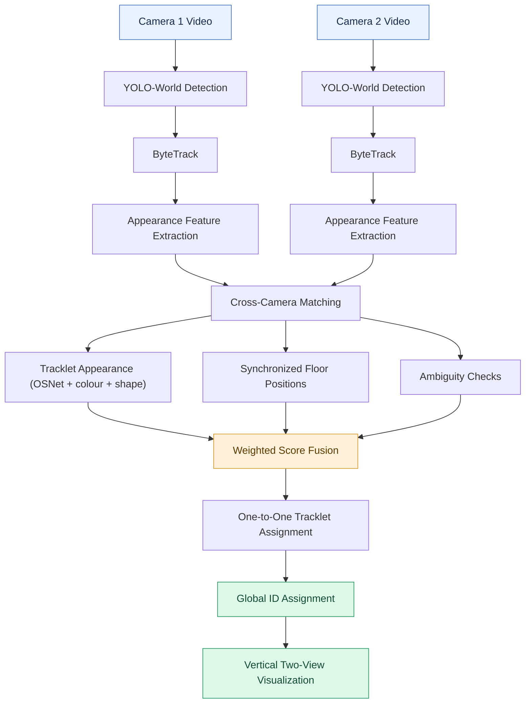

<div align="center">

# Cross Camera ReID

### People and Humanoid Robot Detection Across Two Camera Views

A computer vision project that detects and tracks people and humanoid robots in two synchronized views, then links full tracklets only when appearance and calibrated floor-position evidence agree.

<br>


<br>

**Detect &nbsp; • &nbsp; Track &nbsp; • &nbsp; Match &nbsp; • &nbsp; Re-identify**

</div>

---

## Overview

Tracking objects across multiple cameras requires more than detecting them in individual frames. The same object may appear at different positions, scales, and viewing angles, making cross-camera identity matching challenging.

**Cross Camera ReID** combines object detection, local tracking, visual appearance, motion patterns, spatial consistency, and temporal information to associate corresponding tracks across two synchronized camera views.

Each camera maintains its own local track IDs. The system compares tracks across cameras and assigns consistent global identities when a sufficiently reliable match is established.

The approach can be applied to different detectable object categories, such as people and vehicles, depending on the detection model and the suitability of the matching features.

## Features

<table>
<tr>
<td width="50%" valign="top">

### 🎯 Object Detection

Uses YOLO-World open-vocabulary detection for people and humanoid robots.

</td>
<td width="50%" valign="top">

### 🔗 Multi-Object Tracking

Uses ByteTrack to associate detections across consecutive frames.

</td>
</tr>
<tr>
<td width="50%" valign="top">

### 🎨 Person Re-identification

Uses an OSNet-AIN person-ReID model across multiple observations, with clothing-colour and coarse body-shape features as supporting evidence.

</td>
<td width="50%" valign="top">

### 📐 Shared-Floor Calibration

Maps the two views using manually paired floor landmarks, then checks whether candidate tracklets occupy the same physical position at the same time.

</td>
</tr>
<tr>
<td width="50%" valign="top">

### ⏱️ Temporal Matching

Uses track lifetimes, first-appearance timing, and temporal overlap.

</td>
<td width="50%" valign="top">

### 🌐 Global Identity Assignment

Uses weighted similarity scores and the Hungarian algorithm to match tracks across cameras.

</td>
</tr>
<tr>
<td width="50%" valign="top">

### ✅ Conservative Matching

Rejects uncertain or ambiguous candidate pairs instead of forcing a global ID assignment.

</td>
<td width="50%" valign="top">

### 🎬 Combined Visualization

Displays both camera views vertically for inspecting tracking and identity assignments.

</td>
</tr>
</table>

---

## How It Works



### 1. Object Detection and Local Tracking

YOLO-World uses the text prompts `person` and `humanoid robot`, so it can search for robots without a custom fixed-class model. The current configuration uses the YOLOv8s-Worldv2 checkpoint and runs detections on every frame. ByteTrack maintains separate local IDs for each camera.

ByteTrack associates detections across consecutive frames and maintains local track IDs independently for each camera.

### 2. Tracklet Appearance Features

The system extracts person-ReID embeddings using OSNet-AIN and combines them with upper/lower HSV colour histograms and a coarse body-shape descriptor. It accumulates evidence from multiple frames for each local track. For robots, the matcher gives more weight to colour and shape because OSNet was trained for people.

These features help measure visual similarity between tracks observed in different camera views.

### 3. Camera-Floor Calibration

The two videos are processed on a shared frame timeline. Since they show the same scene from opposite viewpoints, `calibrate_cameras.py` asks for corresponding floor landmarks. The resulting homography maps Camera 2 foot points into Camera 1 coordinates. Use at least four clear, well-spread floor points; eight or more is preferable.

This check is useful only when the views are synchronized and the person’s feet are visible on the same floor plane. It does not make different people occupying the same area at different moments equivalent.

### 4. Tracklet Matching and Global IDs

After both videos are processed, the code compares complete camera-local tracklets. It requires enough shared timestamps, a close median floor-position error, a minimum ReID score, and a clear margin over alternative candidates. A Hungarian assignment enforces one-to-one matching. Uncertain pairs keep their camera-local IDs rather than receiving a potentially false global ID.

The score combines appearance, shared-floor position, and temporal overlap:

<div align="center">

\[
\boxed{S = W_A S_A + W_S S_S + W_T S_T}
\]

</div>

Where:

| Symbol | Description |
|:--|:--|
| \(S_A\) | Appearance similarity |
| \(S_S\) | Shared-floor position consistency |
| \(S_T\) | Synchronized temporal overlap |
| \(W_A\) | Appearance weight |
| \(W_S\) | Shared-floor position weight |
| \(W_T\) | Temporal weight |

For people, the current configuration uses the following score weights:

| Component | Weight |
|:--|--:|
| Appearance similarity | 0.70 |
| Shared-floor position consistency | 0.25 |
| Temporal similarity | 0.05 |

Robot appearance similarity uses a separate mix: 0.20 OSNet, 0.62 colour, and 0.18 shape.

These thresholds are starting points, not an accuracy guarantee. False re-identification is possible when clothing is similar, detections are poor, the videos are not synchronized, or calibration is inaccurate.

### 5. Visualization

The final output stacks the two camera views vertically, allowing the tracking results and cross-camera identity assignments to be inspected together.

---

## Matching Strategy

The system combines three complementary sources of information.

| Matching Signal | Information Used | Purpose |
|:--|:--|:--|
| **Appearance** | OSNet-AIN embeddings, upper/lower HSV colour histograms, and a coarse body-shape descriptor | Compares visual characteristics across multiple observations |
| **Floor position** | Simultaneous foot points projected with the manual camera calibration | Checks whether both detections can be the same person in the same scene |
| **Time** | Shared frame indices | Ensures candidate tracks overlap in synchronized time |

Combining these signals reduces dependence on appearance alone and provides multiple sources of evidence when matching tracks across cameras.

---

## Technology Stack

| Technology | Role |
|:--|:--|
| **Python** | Core implementation |
| **OpenCV** | Video processing, colour features, and homography estimation |
| **YOLOv8s-Worldv2** | Open-vocabulary person and humanoid-robot detection |
| **ByteTrack** | Within-camera multi-object tracking |
| **Torchreid OSNet-AIN** | Person-ReID feature extraction |
| **NumPy** | Numerical computations and feature processing |
| **SciPy** | Hungarian assignment algorithm |

---

## Potential Applications

The underlying approach can be useful in several multi-camera video analysis scenarios.

| Application | Possible Use |
|:--|:--|
| 🚗 Traffic Monitoring | Associating detected vehicles across camera views |
| 👥 Surveillance | Matching detected people across multiple viewpoints |
| 🏙️ Smart Cities | Analysing object movement across monitored areas |
| 🏬 Retail Analytics | Studying object movement within monitored spaces |
| 📹 Video Analytics | Maintaining consistent identities across camera feeds |

*These are potential applications of the general approach, not claims that the current implementation has been validated for every object category or scenario.*

---

## Limitations

- **Camera configuration:** The current implementation is designed for two synchronized views of the same scene.
- **Detection performance:** Results depend on the detector's ability to recognize the objects in the videos.
- **Appearance differences:** Lighting, occlusion, similar-looking objects, and viewpoint changes can reduce matching accuracy.
- **Feature suitability:** The current appearance pipeline uses OSNet-AIN embeddings, colour histograms, and a coarse body-shape descriptor. These features may still fail for small, occluded, or visually similar people.
- **Spatial estimation:** Matching depends on accurate manual floor calibration and visible foot points. A planar homography does not model people at different heights or severe perspective effects perfectly.
- **Synchronization:** Corresponding frames must represent approximately the same time; adjust `CAM2_OFFSET_FRAMES` in `config.py` if one video starts later.
- **Model weights:** On the first run, the project downloads pinned YOLOv8s-Worldv2 and OSNet-AIN checkpoints into this project’s `models/` folder (with `osnet_reid.pth` kept at the project root for compatibility), then checks their SHA-256 before loading. The files are not included in the code-and-video transfer.
- **Processing time:** YOLO-World runs on every frame so ByteTrack can update from fresh detections. The input is resized internally to 960 pixels for detection; the saved output retains the original video resolution. A CUDA-enabled GPU is recommended for full-length videos.
- **Tracking errors:** Incorrect or fragmented local tracks can affect cross-camera identity assignments.

---

## Setup and Run

Keep the environment, model files, videos, calibration, and output in this project directory. From the project folder, run:

Use **`pipeline.py`** as the current entry point. `pipeline1.py` and `1pipeline.py` are older prototypes and do not use the current tracklet matching and calibration workflow.

```bash
sudo apt update
sudo apt install -y python3-venv python3-pip libgl1 libglib2.0-0
python3 -m venv .venv
source .venv/bin/activate
python -m pip install --upgrade pip
# Install PyTorch for this machine's GPU using the selector at https://pytorch.org/get-started/locally/
python -m pip install torch torchvision
python -m pip install -r requirements.txt
python -m pip install --no-build-isolation git+https://github.com/KaiyangZhou/deep-person-reid.git
```

If `.venv` already exists, activate it and install the missing packages; do not recreate it. For a GPU computer, install the PyTorch build that matches its CUDA driver using the official PyTorch selector linked above; `pip install torch torchvision` may select CPU-only depending on the platform and package index. The first `python pipeline.py` run downloads both pinned model checkpoints into this project and validates them. Keep `cam1.mp4` and `cam2.mp4` beside the Python files. Model downloads require access to Hugging Face.

Then, with `.venv` activated, run:

```bash
python calibrate_cameras.py
python pipeline.py
```

In the calibration window, click each shared floor landmark in Camera 1, then the same landmark in Camera 2. Use at least four matching landmarks spread across the visible floor; more well-spread points are better. Press Enter to save `camera_calibration.json`. To redo the points press `r`; press `q` to quit. During the first processing pass, a live vertically stacked preview shows detections and camera-local track IDs. The preview is scaled to fit a 1280×900 window; adjust `PREVIEW_MAX_WIDTH` and `PREVIEW_MAX_HEIGHT` in `config.py` for your display. Detection and the saved output keep their original resolution. Cross-camera global IDs are assigned after the full first pass, then the final output is rendered to `reid_output.mp4`. Press `q` during final rendering to stop it early; use Ctrl+C in the terminal to stop processing during the first pass.

The current videos should be synchronized. If not, change `CAM2_OFFSET_FRAMES` in `config.py` before running. A global ID is assigned only to confident tracklet pairs; unmatched people are intentionally shown with camera-local IDs. If no pair qualifies, the terminal reports whether the cause was appearance evidence, synchronization, floor-position error, or an ambiguous match.

---

<div align="center">

## Project Goal

Demonstrate how **object detection, multi-object tracking, appearance recognition, motion analysis, temporal consistency, and assignment optimization** can work together to associate objects across multiple camera views.

<br>

### One System. Multiple Cameras. Consistent Identities.

**Cross Camera ReID**

</div>
